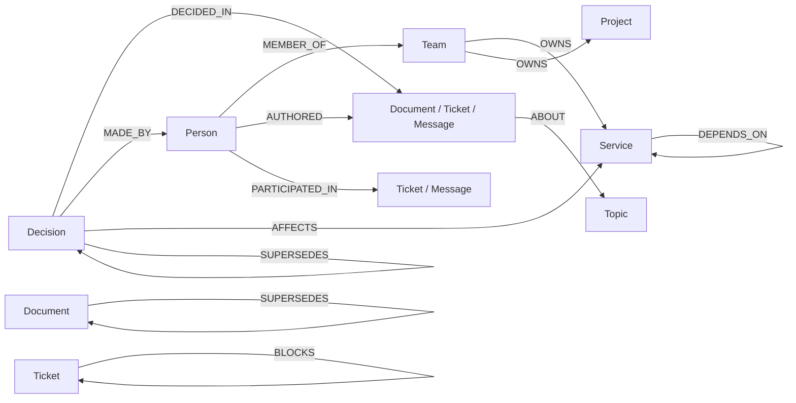

# OrgMind: Company Brain

> Graph Hacks (WeMakeDevs x FalkorDB) | **Track 3: Company Brain**

OrgMind answers questions about how a company works (who owns what, who really knows it, why a
decision was made, whether a doc is still true) using a **FalkorDB graph** of people, teams, services,
documents, tickets, chat messages and decisions. Answers come from **Cypher traversals, not text
search**, and every answer shows its sources and the query used.

---

## Build status (read this first)

The product is **feature-complete in code**: data, graph queries, REST API, agent, live-update ingest and
the React UI are all written. What has **not** happened yet is the first run against a real FalkorDB and a real
`npm install`, because neither was available while this was built. Treat step 1 below as mandatory.

| Area | Status | Where |
|---|---|---|
| Graph data model + indexes | Done | `backend/app/graph.py` |
| Synthetic data (Acme Payments, seeded stories) | Done, tested | `data/generate_data.py` -> `data/seed.json` |
| Idempotent bulk loader (MERGE) | Done | `graph.load_seed`, `python -m app.seed` |
| Core Cypher + node inspect + subgraph/overview queries | Written, **never run on FalkorDB** | `backend/app/queries.py` |
| Agent: tool routing, grounded answers, cache | Done; logic tested with an in-memory mirror | `backend/app/agent.py` |
| LLM wrapper (Gemini / Groq), optional | Written, **never called** (no keys/network) | `backend/app/llm.py` |
| Live-update ingest: LLM extraction + rule fallback | Done; rule path unit-tested | `backend/app/ingest.py` |
| REST API (chat, tools, subgraph, node, ingest) | Written, **not started** (FastAPI not installable here) | `backend/app/main.py` |
| React UI: chat, force graph, sources/Cypher/provenance drawer, live update | Written; syntax-checked and 3 components render-tested; **never built with Vite** | `frontend/` |
| Cache warm-up for demo questions | Done, needs DB | `python -m app.warm_cache` |
| Docker (FalkorDB, optional API image) | Done, untested | `docker-compose.yml`, `Dockerfile` |
| Deployment, demo video, diagrams | **TODO** | see "What to do next" |

### What is and is not tested

- **Tested (no DB, no network):** `python tests/test_seed.py` (9 tests: seeded stories, counts, edge integrity,
  rule parser) and `python tests/test_agent.py` (11 tests: routing for all 6 demo questions, argument matching,
  every tool's answer, decision chain following, grounding check, cache). The agent tests run against
  `tests/fake_queries.py`, a pure-Python mirror of the Cypher semantics built from `seed.json`.
- **Not tested:** that the Cypher is valid in FalkorDB's dialect and returns the same thing as the Python mirror;
  the LLM calls; the HTTP layer; the Vite build and the force-graph rendering.

---

## Quick start

```bash
# 1. FalkorDB (browser UI at http://localhost:3000)
docker compose up -d

# 2. Backend
cd backend
python -m venv .venv && source .venv/bin/activate        # Windows: .venv\Scripts\activate
pip install -r requirements.txt
cp ../.env.example ../.env                                # add GEMINI_API_KEY or GROQ_API_KEY if you want the LLM
python -m app.seed --reset                                # load the graph from ../data/seed.json
python -m app.verify_queries                              # <-- every query must print OK
python -m app.warm_cache                                  # optional: pre-compute demo answers
uvicorn app.main:app --reload --port 8000                 # API docs: http://localhost:8000/docs

# 3. Frontend (new terminal)
cd frontend
cp .env.example .env
npm install && npm run dev                                # http://localhost:5173
```

`python data/generate_data.py` regenerates `seed.json` (deterministic). Without an LLM key everything still
works: questions are routed by rules and answers are written from templates (the UI shows `routed: rules`,
`answer: template`). With a key, the LLM picks the tool and writes the answer from the returned rows only.

Run the no-DB tests anytime: `python tests/test_seed.py && python tests/test_agent.py`

### API

| Endpoint | Purpose |
|---|---|
| `POST /api/chat {question}` | Agent: answer + `tool`, `cypher`, `params`, `rows`, `sources`, `highlight`, `chain`, `warnings` |
| `GET /api/expert?topic=` `/api/owner?service=` `/api/blast-radius?service=` `/api/bus-factor` `/api/stale-docs` | Direct tools (rows + Cypher) |
| `GET /api/decisions?q=` `/api/decision/{id}` | Find and trace decisions |
| `GET /api/subgraph?ids=a,b,c&expand=true` | Nodes + links for highlighting an answer |
| `GET /api/graph/overview` | Teams, services, projects and their edges (default map) |
| `GET /api/node/{id}` | Properties and neighbours of any node (click-to-inspect) |
| `POST /api/ingest {text, author}` | Live update; clears the answer cache |
| `GET /api/demo-questions` `/api/topics` `/api/people` `/health` | Helpers |

### Demo script (the 7 PRD questions)

1. "Who should I ask about payment retries?" 2. "Why did we move to Postgres, and is that still the plan?"
3. "What breaks if the ledger service goes down?" 4. "Which topics only one person understands?"
5. "Which docs are outdated?" 6. "Who owns the notifications service and who is the backup?"
7. Click **Live update**, ingest the prefilled message (reverses D-008, Kafka -> SQS). The UI highlights the new
   nodes, then asks "Is D-008 still the plan?" and the answer flips to "no longer current".

---

## Why the graph is essential (rule 3 check)

Remove FalkorDB and these features stop working: multi-hop dependency blast radius, supersede chains,
expertise ranking across person -> artifact -> topic paths, and bus-factor detection. Vector search cannot
answer them, because the answer is a property of the *structure* (paths, counts of distinct neighbours,
absence of an incoming edge), not of any single piece of text.

| Feature | Graph operation | Why text/vector search fails |
|---|---|---|
| Blast radius | `(:Service)<-[:DEPENDS_ON*1..3]-(:Service)` | Dependencies are transitive; no document states the full closure |
| Is this decision current? | Absence of an incoming `SUPERSEDES` edge | "Not mentioned anywhere" is not retrievable |
| Who knows X | Count over `Person -> Artifact -> Topic` paths | Needs aggregation across three entity types |
| Bus factor | Topics whose authors collapse to exactly 1 person | A negative/cardinality fact, not content |
| Stale docs | Incoming `SUPERSEDES` OR author with `active:false` | Joins document state to person state |

## Graph data model



Nodes: Person, Team, Service, Project, Document, Ticket, Message, Topic, Decision. Indexes on `id` for every
label and on `Topic.name`. Two small additions to the PRD model: `Service.topic` (primary topic, used to rank
owner/backup) and `Topic.service` (so ingest can attach `AFFECTS` edges).

## The Cypher (all in `backend/app/queries.py`)

Adapted from the PRD for FalkorDB's Cypher subset:
- **Expertise**: `AUTHORED` counts 2, `PARTICIPATED_IN` counts 1 (`sum(CASE WHEN type(r)=...)`).
- **Stale docs**: PRD used `EXISTS { ... }` subqueries; replaced with `OPTIONAL MATCH ... WHERE x IS NOT NULL OR ...` to stay inside the supported subset.
- **Bus factor**: uses parallel `collect()` lists (`names[0]`) instead of list-of-maps indexing.
- **UI queries** (`GET_NODE`, `NODE_OUT/IN`, `OVERVIEW`, `SUBGRAPH_*`): feed the graph panel and click-to-inspect.
- **Owner + backup**: owner query plus expertise ranking on the service's topic, with warnings (no active backup, thin backup, departed members).

## Architecture

```
React + Vite  --HTTP-->  FastAPI  --Cypher-->  FalkorDB
 Chat | GraphView | Sources/Cypher/Provenance     |
                          |-- agent.py   choose_tool (LLM JSON, validated; rule router fallback)
                          |              run_tool    (queries.py, the only place Cypher lives)
                          |              write_answer (LLM from rows only; grounding check; template fallback)
                          |-- ingest.py  LLM extraction + rule fallback, MERGE writes, SUPERSEDES linking
                          '-- queries.py Cypher + wrappers returning rows AND the query text
```

Design decisions worth being able to explain:
- **The LLM never writes Cypher.** It only picks one of 6 tools and fills validated arguments; the Cypher is fixed and reviewable.
- **Grounding:** the answer may only cite ids that appear in the returned rows; otherwise the template answer is used.
- **Tool choice** is JSON-from-the-LLM validated against allowed topics/services (not native function-calling), which keeps Gemini and Groq interchangeable.
- **Decision tracing** resolves free text to a decision by token overlap (earliest match = origin of a chain), then follows `SUPERSEDES` forward to the current decision.
- **Cache** is cleared on every ingest, because a live update changes answers.

## Synthetic data: Acme Payments

40 people, 6 teams, 12 services, 4 projects, 20 topics, 25 documents, 60 tickets, 150 messages, 12 decisions,
~1000 edges. Seeded stories:

| Story | What is in the graph |
|---|---|
| Reversed DB migration | D-001 (MySQL->Postgres) superseded by D-002 (roll back); RFC-012 superseded by the rollback postmortem |
| Engineers who left | Marcus Webb (Notifications, left 2026-03) and Tom Fischer (Platform, left 2025-11), both `active:false` |
| Single-owner topics | `settlement-reconciliation` (Jamal Iyer), `hsm-key-rotation` (Sam Okafor), `notification-templates` (Marcus Webb, departed) |
| Outdated auth RFC | Auth RFC v1 (Tom Fischer) superseded by v2; D-003 superseded by D-004 |
| Weak backup | Notifications team has 3 people: Priya (17), Marcus (left), Dev (8) |
| Live-update target | D-008 (Kafka->SQS, supersedes D-007); `data/live_update_example.json` reverses it |

Expected results to compare against once the DB is up: `payment-retries` experts -> Diego Park (15),
Elena Joshi (11); `notification-queue` -> Priya Nair (17), Marcus Webb (14, inactive), Dev Malhotra (8);
ledger blast radius -> payments-api, retry-engine, settlement (hop 1), then api-gateway, merchant-dashboard,
webhooks (hop 2); bus factor -> the 3 topics above; stale docs -> 5 documents (Auth RFC v1, Kafka design,
RFC-012, the template-engine notes, and one filler doc by a departed author).

---

## What to do next (in order)

1. **First run and fix dialect errors (most important).** `python -m app.verify_queries` must print OK for all
   queries. Likely trouble spots: `collect(DISTINCT x.id)[..5]` slicing; map literals inside `collect()` in
   `TRACE_DECISION`; `labels(x)[0]` and `coalesce` inside map literals; `CASE` inside `collect()` in `STALE_DOCS`;
   `type(r)` on `[:AUTHORED|PARTICIPATED_IN]`; `NOT (labels(b)[0] IN [...])` in `SUBGRAPH_EXPAND`; `MATCH (n {id: $id})` without a
   label. Then compare against the expected results below. The in-memory mirror in `tests/fake_queries.py` shows
   what each query *should* return.
2. **Smoke test the API**: `curl localhost:8000/health`, then the 6 demo questions via `POST /api/chat`.
3. **`npm install && npm run dev`** and fix anything the Vite build reports. Check the graph highlights the right nodes and
   that the live-update flow works end to end (message -> SUPERSEDES edge -> "no longer current").
4. **Add an LLM key** (Gemini or Groq), confirm the model names in `llm.py` still exist on the free tier (override with
   `GEMINI_MODEL` / `GROQ_MODEL`), and check the UI shows `routed: llm` / `answer: llm`. If answers keep falling back to
   `template`, the grounding check is rejecting them; read the rows and the prompt in `agent.write_answer`.
5. **`python -m app.warm_cache`** after seeding, so the 6 demo answers survive rate limits.
6. **Deploy:** FalkorDB Cloud (free tier; set `FALKORDB_HOST/PORT/USERNAME/PASSWORD/SSL`), API on Render/Railway (the root
   `Dockerfile` works; run `python -m app.seed --reset` once against the cloud DB), UI on Vercel (`VITE_API_URL`; add the
   Vercel URL to `CORS_ORIGINS`). **Record the demo video from the local setup first.**
7. **Docs and submission:** export the mermaid data model to an image in `docs/`, add a screenshot of the UI, fill in the
   AI-disclosure below, create the public GitHub repo, name the track *Company Brain*, and be ready to explain every query.

### Optional polish if time allows
- Show a bus-factor / stale-docs badge on nodes in the map; add a "risk" overview question.
- Streaming answers; keyboard shortcuts; node search box.
- More synthetic stories (a second reversal chain) for a richer demo.

## Repo layout

```
orgmind/
  backend/app/   main.py graph.py queries.py agent.py llm.py ingest.py seed.py verify_queries.py warm_cache.py
  backend/       requirements.txt
  data/          generate_data.py  seed.json  live_update_example.json  (answer_cache.json after warm_cache)
  frontend/      src/{App.jsx, api.js, styles.css, components/{Chat,GraphView,SourcesPanel,LiveUpdate}.jsx}
  tests/         test_seed.py  test_agent.py  fake_queries.py
  docs/          (add diagrams + screenshot)
  Dockerfile  docker-compose.yml  .env.example  README.md
```

## AI-assistance disclosure

Fill in before submitting. Suggested text: "The PRD, project scaffolding, synthetic data generator, Cypher
queries and API were drafted with Claude (Anthropic) and reviewed, tested and understood by me."
